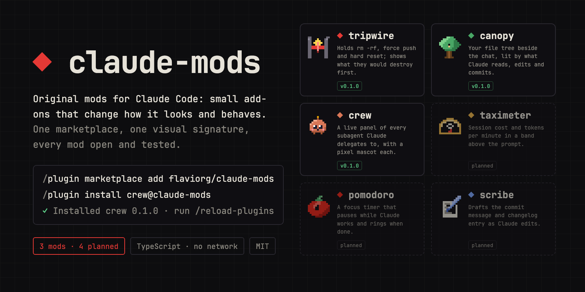
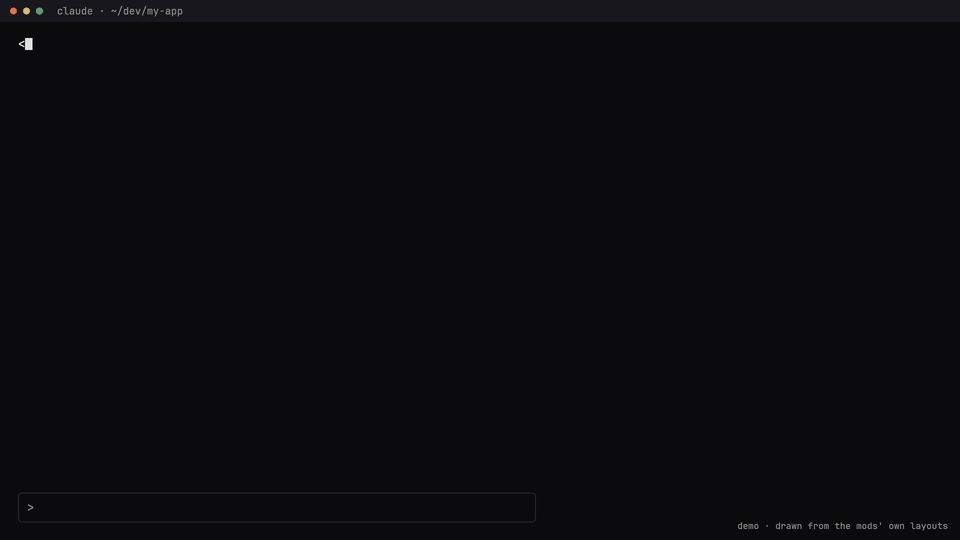

<div align="center">



# ◆ claude-mods

**Original mods for Claude Code: small add-ons that change how it looks and behaves, written from scratch against the official mods API.**

[](https://code.claude.com/docs/en/plugins/mods/overview)
[](#the-mods)
[](docs/conventions.md)
[](LICENSE)



<sub>An animation drawn from the mods' own layouts, not a screen recording. Clock runs 20× faster.</sub>

</div>

Each mod lives in its own repository and installs on its own. This repository is the family
marketplace: add it once and install any of them.

```text
/plugin marketplace add flaviorg/claude-mods
/plugin install tripwire@claude-mods
/plugin install canopy@claude-mods
/plugin install crew@claude-mods
```

Then start a new session, or run `/reload-plugins`.

## The mods

<table>
<tr>
<td width="72" align="center"></td>
<td><b><a href="https://github.com/flaviorg/tripwire">tripwire</a></b> &nbsp;<code>0.1.0</code><br>
Holds a destructive command (<code>rm -rf</code>, force push, hard reset, <code>DROP TABLE</code>…) and shows what it would destroy before it runs. You cancel or proceed. Cancel is the default.</td>
</tr>
<tr>
<td align="center"></td>
<td><b><a href="https://github.com/flaviorg/canopy">canopy</a></b> &nbsp;<code>0.1.0</code><br>
Your project's file tree beside the chat. Every file Claude touches keeps its state in its own color: being edited, edited, committed, being read, read.</td>
</tr>
<tr>
<td align="center"></td>
<td><b><a href="https://github.com/flaviorg/crew">crew</a></b> &nbsp;<code>0.1.1</code><br>
A live panel of the subagents Claude delegates to: model, context, tokens, cost and time, each with its own animated pixel mascot. A one-line band above the prompt while anything runs.</td>
</tr>
</table>

<details>
<summary><b>See them in action</b></summary>
<br>
<table>
<tr>
<td align="center"><a href="https://github.com/flaviorg/tripwire"></a><br><sub>tripwire</sub></td>
<td align="center"><a href="https://github.com/flaviorg/canopy"></a><br><sub>canopy</sub></td>
</tr>
<tr>
<td align="center" colspan="2"><a href="https://github.com/flaviorg/crew"></a><br><sub>crew</sub></td>
</tr>
</table>
</details>

## Planned

Next in line, in no fixed order. Open an issue if one of them matters to you; it moves up.

<table>
<tr>
<td width="72" align="center"></td>
<td><b>taximeter</b> &nbsp;<sub>planned</sub><br>A band above the prompt with the session's real cost, tokens per minute and where it is heading.</td>
</tr>
<tr>
<td align="center"></td>
<td><b>pomodoro</b> &nbsp;<sub>planned</sub><br>A focus timer in the band that pauses while Claude works and rings when it is done.</td>
</tr>
<tr>
<td align="center"></td>
<td><b>scribe</b> &nbsp;<sub>planned</sub><br>Drafts the commit message and changelog entry as Claude edits; <code>/changelog</code> copies it.</td>
</tr>
<tr>
<td align="center"></td>
<td><b>radar</b> &nbsp;<sub>planned</sub><br>Runs the affected tests after each edit and shows green or red per file, like a local CI.</td>
</tr>
</table>

## How they are built

Every mod follows the same rules, written down in [`docs/conventions.md`](docs/conventions.md):

- **TypeScript ES modules**, no bundler, no `node_modules`. One file touches the mods API; the rest is pure and unit-tested.
- **`claude plugin validate --strict` clean** and **`claude plugin test` green** before any release.
- **Guards fail closed.** A hook that can block a command returns a deny when it cannot decide.
- **No network, no telemetry.** Nothing leaves your machine.
- **One visual signature.** Every pane opens with `◆ <name>`, one accent color per mod, the same glyphs for the same states.

## Trust

A mod runs with your permissions inside Claude Code. Before installing any of these, you can
list exactly what it does without running it:

```bash
git clone https://github.com/flaviorg/tripwire && claude plugin validate ./tripwire
```

The `calls:` line lists every mods API call the mod makes.

## Contributing

Issues and pull requests go to the mod's own repository. A pull request is checked against
the conventions above; the quick loop is:

```bash
claude plugin validate --strict .
claude plugin test .
claude --plugin-dir .
```

## License

[MIT](LICENSE) © [flaviorg](https://github.com/flaviorg)
